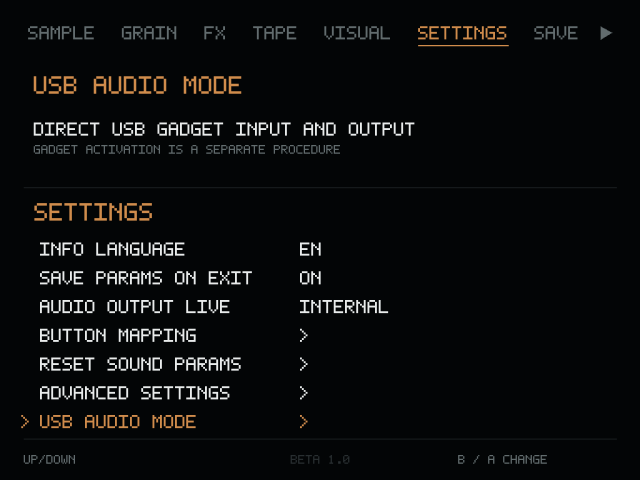
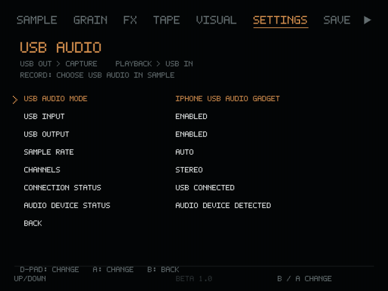

> **Устарело (6 ноября 2026).** Это отчёт о попытках на KNULLI и самосборном ROCKNIX. Рабочая схема — официальный ROCKNIX + модули из `rocknix/` + маршрутизация через PipeWire: см. [README](../README_RU.md#iphone--usb-звук).

# USB Audio Gadget: реализация и проверка

Состояние на 4 ноября 2026 года: программная интеграция реализована;
двусторонняя передача на физической RG40XX H и iPhone **не подтверждена**.
По умолчанию режим **Disabled**. Запуск приложения и диагностики не меняет
ConfigFS, USB-роль, зарядку, системный ALSA или настройки KNULLI.

## Архитектура актуальной версии

Аудит выполнен для `origin/main`, исходный коммит
`c91e9df7705f9a424606ac7405767150c780b35a`, и локального официального
ARM64-дистрибутива GrainBrick beta 1.0.1. Его баннер внутри бинарного модуля
пишет `v0.0.4`, поэтому один баннер не используется для определения релиза.
Закрытые файлы приложения и DSP не изменяются и не входят в патч.

| Компонент | Фактическое поведение |
|---|---|
| `gb_launch.py` | Python 3.12 ARM64, системный Pygame, NumPy 1.26.4 из `_vendor`; затем импорт закрытого `main` |
| `gb_audio.py` | Старый адаптер beta 1.0: меняет `arecord hw:1,0` на внешний USB Capture; на 1.0.1 выключен по умолчанию |
| `engine.audio_inputs.available_usb_captures()` | В 1.0.1 ищет USB-host аудиокарты; gadget без USB-host `usbid` может не попасть в список |
| `engine.audio_devices` | `available_outputs()` возвращает `(id, label, pcm)`, `resolve_output(id)` выбирает PCM |
| `engine.audio.AudioOutput` | Собственный `aplay`, raw S16_LE, stereo, 48000 Hz; отдельные методы запуска, смены PCM и остановки |
| `engine.audio_worker.AudioWorker` | Отдельный процесс DSP; запрос смены выхода обрабатывается на границе блока |
| `engine.audio_recorder.AudioRecorder` | Отдельный `arecord`, WAV, методы start/stop/cancel |
| `gb_advanced.py` | Обёртки публичных классов Settings/Input/ParameterBus; сохранены XY, макросы, пресеты и кнопки |

Новый адаптер расширяет **реальные** списки устройств, включая импортированные
ссылки на функции в других модулях. Сам GrainBrick открывает свои `arecord`
и `aplay`. Нет петли Capture → Playback, дополнительного микшера, `snd-aloop`
или программного аудиомоста. Внешние USB-интерфейсы продолжают использовать
штатный механизм, а legacy-адаптер остаётся доступным.

| Передача | USB с точки зрения iPhone-хоста | PCM на Anbernic | Параметры UAC2 Linux 4.9 |
|---|---|---|---|
| iPhone → сэмплер | OUT | Capture / `arecord` | `c_chmask`, `c_srate`, `c_ssize` |
| GrainBrick → iPhone | IN | Playback / `aplay` | `p_chmask`, `p_srate`, `p_ssize` |

Для отправки и приёма выбираются **разные направления PCM одной карты**.
Номер карты не фиксирован. Карта определяется по gadget-идентификаторам
ядра (`UAC2_Gadget`, `UAC2Gadget`, UAC1 и др.) или её ConfigFS ancestry;
USB-host карты с `usbid` исключаются. Используется `plughw:CARD=<id>,DEV=<n>`.
При нескольких gadget-картах или PCM требуется явный выбор в JSON, вместо
случайного выбора первой карты. Необычное имя неизвестного драйвера требует
дополнения обнаружения после анализа его sysfs; произвольная внешняя карта
не будет принята за gadget только из-за слова USB.

Снимки настоящего UIEngine в эмуляторе, приведённые к 640×480 (не фото консоли):





## Что найдено в KNULLI

Проверка на RG40XX H с KNULLI 4.9.170 #13 подтвердила загрузку штатного
`usb_f_uac2.ko`, но привязка UAC2 при подключении к ПК завершилась ошибкой
`afunc_bind:1077`. Бинарник модуля на консоли совпал с модулем из образа.
Дизассемблирование показывает, что строка 1077 срабатывает, когда
`usb_ep_autoconfig()` не находит изохронный USB IN. При откате ядро упало
в `afunc_unbind()`, поэтому ALSA-карта UAC2 не появилась.

В [родственном исходнике контроллера Sunxi](https://raw.githubusercontent.com/orangepi-xunlong/linux-orangepi/orange-pi-4.9-sun50iw9/drivers/usb/sunxi_usb/udc/sunxi_udc.c)
объявлен один изохронный endpoint для обоих направлений. Это согласуется
с результатом теста, но возможности самого контроллера за пределами
штатного драйвера ещё не проверены. Для следующей попытки нужны драйвер UDC
с поддержкой обоих направлений и корректная обработка ошибок привязки UAC2.
План показывает `blocked_reason`, а `--apply` отклоняет активацию с известным
модулем на этом контроллере до записи в ConfigFS.

### Тестовая сборка с MUSB

ROCKNIX 20261101 для H700 использует Linux 7.1.2 с MUSB Sunxi и ConfigFS.
В MUSB для USB IN и OUT предусмотрены раздельные буферы. В штатном
ROCKNIX параметр `USB_CONFIGFS_F_UAC2` выключен. Патч ниже включает его
в сборке ядра H700.
[Исходная конфигурация ROCKNIX](https://github.com/ROCKNIX/distribution/blob/cefc14339a4ae18c02bb69888f27835e50664b60/projects/ROCKNIX/devices/H700/linux/linux.aarch64.conf), [исходник MUSB Sunxi](https://github.com/torvalds/linux/blob/v7.1/drivers/usb/musb/sunxi.c).

Проверка сборки на Linux с AArch64 GCC, `make`, `flex`, `bison`, `bc`,
заголовками OpenSSL и ELF и `fdtget` из пакета `device-tree-compiler`.
Входные данные — распакованные исходники ROCKNIX на коммите
`cefc14339a4ae18c02bb69888f27835e50664b60` и архив Linux 7.1.2 с kernel.org.

```sh
bash tools/build_h700_uac2.sh /path/to/rocknix-20261101 \
  /path/to/linux-7.1.2.tar.xz /path/to/new-build-dir
```

Скрипт сверяет SHA-256 архива Linux, накладывает патчи ROCKNIX, компилирует
ARM64-объекты MUSB и UAC2 и проверяет `status = "okay"` и `dr_mode = "otg"`
в DTB стандартного RG40XX H и варианта `rg40xx-h-v2-panel`.
`BUILD_IMAGE=1` дополнительно собирает ARM64 `Image` без initramfs ROCKNIX.
Это результат проверки сборки ядра. Запуск на консоли и передача звука в
обе стороны требуют отдельного теста.

Для загрузочного образа применить патч к исходникам ROCKNIX и запустить
официальную сборку H700 в её штатной среде:

```sh
git apply --check /path/to/GrainBernik_repo/tools/rocknix-h700-uac2.patch
git apply /path/to/GrainBernik_repo/tools/rocknix-h700-uac2.patch
make docker-H700
```

Для проверки использовать запасную microSD и вариант загрузчика DDR и DTB,
соответствующие конкретной плате. После загрузки проверить UDC и
`CONFIG_USB_CONFIGFS_F_UAC2=y`. С ПК в роли USB-хоста проверить появление
обоих PCM и выполнить дуплексный тест D, затем повторить с iPhone и отдельно
проверить GrainBrick по тесту E. Ядро ROCKNIX рассчитано на его загрузчик,
DTB и системные модули. [Сборка ROCKNIX](https://rocknix.org/contribute/build/), [установка H700](https://rocknix.org/configure/h700-installation/).

Исследован **локальный образ**
`knulli-h700-rg40xx-h-scarab-20260511.img`, а не работающая консоль.
[Машиночитаемый отчёт с SHA-256 ядра, конфигурации и модуля](USB_AUDIO_IMAGE_AUDIT.json).

| Параметр | Встроенная конфигурация ядра образа |
|---|---|
| Версия | Allwinner BSP 4.9.170, сборка 25 декабря 2025 |
| `CONFIG_USB_GADGET` | `y` |
| `CONFIG_CONFIGFS_FS`, `CONFIG_USB_CONFIGFS`, `CONFIG_USB_LIBCOMPOSITE` | `y` |
| `CONFIG_USB_SUNXI_UDC0` | `y` |
| `CONFIG_USB_CONFIGFS_F_UAC1`, `CONFIG_USB_CONFIGFS_F_UAC2` | `n` |
| `CONFIG_USB_F_UAC2` | Символ отсутствует в сохранённом config; это не доказательство отсутствия модуля |
| `CONFIG_SND_USB_AUDIO` | `y`, относится к USB-host аудиоустройствам |
| `CONFIG_SND_ALOOP` | `n`; для прямой интеграции не нужен |
| `CONFIG_USB_CONFIGFS_F_AUDIO_SRC` | `y`, односторонний Android audio_source |

**Существенное расхождение:** в SquashFS этого же образа есть отдельно
поставленный `usb_f_uac2.ko`: alias `usbfunc:uac2`, dependency `libcomposite`,
vermagic `4.9.170 SMP preempt mod_unload modversions aarch64`.
В модуле найдены все шесть атрибутов duplex UAC2. Есть также `g_audio.ko`.
Следовательно, запрещено выводить «UAC2 невозможен» только из встроенного
config либо наличия/отсутствия отдельного `.ko`. Совпадение vermagic тоже
не гарантирует совместимость modversions, наличие экспортированных символов,
успешную привязку или работоспособность изохронных endpoints. Если независимый
SSH/локальный терминал доступен, `modinfo usb_f_uac2` проверяет метаданные,
а явный `modprobe usb_f_uac2` с последующим чтением dmesg проверяет загрузку
(это уже изменение системы и не часть read-only диагностики).

`/etc/init.d/S28usbmode` в образе создаёт `g1/configs/b.1` с `ffs.adb`.
Новый компонент умеет **добавить** свою функцию в явно выбранную существующую
конфигурацию. Он не запускает системный `stop/restart`, не убивает `adbd`,
не удаляет `ffs.adb`, не меняет descriptors, MaxPower или параметры AXP2202.
Совместимость composite ADB+UAC2 и достаточное число endpoints UDC должны
проверяться на устройстве; ошибка binding приводит к восстановлению.

Вне репозитория найден старый экспериментальный скрипт USB Audio Mode.
Он заменяет функции и по умолчанию использует `audio_source`; его комментарий
сообщает о зависании UAC2 при binding на BSP. Это историческая подсказка,
а не воспроизведённый результат. Новый патч его не вызывает и не поставляет.
Пользовательские старые изменения зарядки и системного gadget этот патч
не может восстановить без сохранённого исходного состояния.

## Установка и настройки

1. Скопировать **все** Python-файлы из `rg40xx-h-patch/grainbrick-beta/`
   в `/userdata/roms/ports/grainbrick beta 1.0.1/`, включая новый загрузчик,
   `gb_usb_gadget.py`, `gb_usb_audio.py`, `gb_usb_settings.py`.
2. Скопировать `gb_usb_audio_diag.sh` туда же и
   `GrainBernik USB Audio Diagnostics.sh` в `/userdata/roms/ports/`.
3. Запустить диагностический порт. Получится `usb_audio_diag.json` возле
   приложения. Диагностика не открывает PCM и не меняет настройки системы.
4. В приложении: **SETTINGS → USB AUDIO MODE**. Крестовина выбирает строку
   и меняет значение, A меняет, B возвращает назад. START и L1/R1 сохраняют
   штатные функции. Меню отрисовано настоящим UIEngine и проверено при 640×480.

| Настройка | Значения / поведение |
|---|---|
| USB Audio Mode | Disabled / External USB Audio / iPhone USB Audio Gadget |
| USB Input, USB Output | Независимые Enabled/Disabled |
| Sample Rate | Auto / 48000 Hz |
| Channels | Stereo |
| Connection Status | USB Connected / USB Not Connected / USB Status Unknown |
| Audio Device Status | Audio Device Detected, Input Ready, Output Ready, Full Duplex Active, Audio Device Busy, Driver Not Available, Driver Status Unknown, Audio Device Not Detected, Unsupported Configuration |

Disabled выключает новый gadget-маршрут, сохраняя обычные аудиоустройства.
External USB Audio использует родной выбор USB-интерфейсов GrainBrick.
iPhone USB Audio Gadget выбирает обнаруженный gadget Playback и добавляет
его Capture в штатный источник **USB AUDIO** на странице записи SAMPLE.
Само открытие меню не запускает запись или передачу тестового сигнала.

Настройки сохраняются только в `gb_usb_audio.json` возле приложения.
Исходный Audio Output сохраняется отдельно и возвращается при Disabled,
выключении USB Output, отключении кабеля и завершении приложения. Временный
gadget ID не записывается в родной `settings.json`. При повторном подключении
выход выбирается заново; новую запись нужно запустить вручную. Оборванная
запись обрабатывается штатным AudioRecorder, её следует проверить перед
сохранением в проект. При повреждении JSON режим возвращается в Disabled
и меню показывает ошибку; ошибка записи не меняет текущую настройку.

Продвинутый выбор при неоднозначности, пример части JSON:

```json
{
  "mode": "iPhone USB Audio Gadget",
  "input": true,
  "output": true,
  "rate": "Auto",
  "channels": 2,
  "card_id": "UAC2_Gadget",
  "capture_device": 0,
  "playback_device": 0
}
```

ID и номера здесь **пример**: переписать по отчёту конкретной консоли.
Сначала выключить приложение перед ручным редактированием JSON.

GrainBrick 1.0.1 сам запрашивает stereo S16_LE/48000. Auto оставляет
преобразование к поддерживаемому аппаратному формату ALSA plughw; 48000 Hz
явно обозначает частоту потока приложения. Эта строка меню не переписывает
USB descriptors и не меняет частоту, выбранную хостом. Рекламируемые USB
частота/число каналов/разрядность задаются отдельной процедурой активации;
реальная текущая частота видна в `hw_params`, а при закрытом PCM неизвестна.

Полностью отключить адаптер: `GRAINBERNIK_USB_AUDIO=0` перед запуском Python.
На beta 1.0 без проверенных API новый пункт не добавляется; legacy-адаптер
сохраняет прежнюю работу. Поддержка нового gadget-меню проверена на 1.0.1.

## Диагностика без изменения системы

```sh
cd '/userdata/roms/ports/grainbrick beta 1.0.1'
sh gb_usb_audio_diag.sh > usb_audio_diag.json
# Или без запуска внешних команд:
python3 -B gb_usb_gadget.py > usb_audio_diag.json
```

Отчёт содержит kernel/config, `.ko` и modules.builtin, активные функции и
их ConfigFS links, binding UDC, состояние и скорость контроллера, USB-role,
ALSA IDs и Capture/Playback PCM, атрибуты UAC, status/hw_params всех substreams,
результаты `aplay -l`, `arecord -l`, `lsusb` и релевантный `dmesg`.
Частота и формат открытого PCM выводятся из `hw_params`, число каналов UAC
определяется маской соответствующего направления. У внешних команд ограничено время; отсутствие команды, права чтения,
конфигурации или параметров обозначается как недоступность/unknown.
Перечень PCM не означает, что устройство свободно.

Full Duplex Active появляется только после двух последовательных наблюдений
RUNNING у **обоих** PCM с движением `hw_ptr`, причём owner_pid должен принадлежать
приложению или его потомку. Чужой владелец даёт Audio Device Busy. Открытый,
но неподвижный PCM, одно направление или просто обнаружение iPhone не дают
Full Duplex Active. Этот статус доказывает движение PCM приложения, но сам
по себе не подтверждает отсутствие тишины или запись в приложении iPhone.

При отключении кабеля или направления watcher завершает только принадлежащий
адаптеру `arecord/aplay`, с ограничением ожидания и последующим kill. Штатный
движок получает EOF/ошибку вместо бесконечной записи в pipe. D-state процесса
при зависшем BSP невозможно исправить из Python; может понадобиться перезагрузка.

## Отдельная процедура активации

Только после изучения отчёта на конкретном устройстве. **Не выполнять через
единственный USB/ADB-сеанс:** он прервётся при unbind; процесс должен запускаться
с локальной консоли или независимого SSH-сеанса. Старый BSP способен зависнуть
в kernel syscall; журнал защищает от обычных ошибок, но не исправляет ядро.

Сначала получить план (только чтение), выбрав конфигурацию из своего отчёта:

```sh
python3 -B gb_usb_gadget.py \
  --activate /sys/kernel/config/usb_gadget/g1/configs/b.1
```

Явное применение, при подключённом USB-хосте:

```sh
python3 -B gb_usb_gadget.py \
  --activate /sys/kernel/config/usb_gadget/g1/configs/b.1 \
  --class uac2 --rate 48000 --channels 2 --sample-bytes 2 \
  --apply --allow-disconnect
```

Функция `uac2.grainbernik` добавляется к существующей конфигурации, остальные
links сохраняются. Журнал `gb_usb_gadget_state.json` сохраняется **до** unbind.
Создание функции проверяет фактическую поддержку ядра, включая встроенный
драйвер/автозагрузку. Проверяются шесть атрибутов и прочитанные обратно значения.
Ошибки создания, параметров и binding вызывают rollback. Существующая UAC или
audio_source не заменяется: используется уже работающая UAC либо процедура её
собственного владельца. Единственный занятый другим gadget UDC не отбирается.

Варианты `--rate 44100/96000`, `--channels 1/2`, `--sample-bytes 2/3/4`
доступны для ручных совместимых конфигураций. Приложение остаётся stereo48k
и использует ALSA-конверсию. `--class uac1` разрешён только если фактический
драйвер предоставляет те же duplex PCM-атрибуты; legacy UAC1 Linux 4.9 их не
предоставляет и не выдаётся за рабочую замену UAC2. Автоматического fallback
на односторонний audio_source нет.

Восстановление после эксперимента:

```sh
python3 -B gb_usb_gadget.py --restore --apply
```

Удаляется только собственный link и собственная функция из журнала, возвращается
прежний UDC binding. При чужих изменениях topology/binding восстановление
отказывается работать и оставляет журнал для разбора. После kernel panic,
повреждения карты или сторонней перенастройки автоматическое восстановление
не гарантировано. Загруженный модуль не выгружается: он может использоваться
другими компонентами. Системные разделы не перемонтируются в запись.

Выключение режима в UI останавливает аудиопотоки и возвращает Audio Output.
Созданная **вручную отдельной процедурой** ConfigFS-функция остаётся до явного
`--restore`; UI намеренно не выполняет опасный unbind при смене настройки.
Новая ConfigFS-конфигурация автоматически после перезагрузки не создаётся.

## Проверки A–E на оборудовании

Сначала проверить заряд батареи, data-кабель и реальный OTG/device-порт RG40XX H.
Разъём USB-C сам по себе не доказывает наличие UDC/device mode. Нельзя соединять
два USB-хоста и ожидать gadget. С iPhone USB-C именно iPhone должен быть хостом,
а Anbernic — peripheral. Если Windows сообщает сбой дескриптора устройства,
сначала восстановить стабильное USB-подключение; настройки ALSA это не исправят.
Параметры питания descriptors должны соответствовать реальному потреблению;
этот патч не маскирует потребление и не меняет зарядный контроллер.

Закрыть GrainBrick перед тестами ALSA, чтобы не отбирать его PCM.

**A — перечисление.** После безопасной активации подключить iPhone и проверить
оба аудионаправления в совместимом приложении. Имя «наушники» само по себе
не считается прохождением. Сохранить диагностический отчёт и версию iOS.

**B — iPhone → Anbernic.** Воспроизводить узнаваемый звук на iPhone:

```sh
python3 -B gb_usb_audio.py --test capture --seconds 10 --directory usb-test-B
```

Проверить `capture.wav`, RMS/peak и `non_silent` в `results.json`, затем
прослушать WAV. Порог -70 dBFS отличает цифровую тишину, но шум тоже может
пройти его; сравнить сигнал с известной записью. Проверить оба стереоканала.

**C — Anbernic → iPhone.** Начать запись в GarageBand/совместимом приложении:

```sh
python3 -B gb_usb_audio.py --test playback --seconds 10 --directory usb-test-C
```

Отправляются разные тоны 440/660 Hz по каналам при -24 dBFS. Проверить
запись и прослушивание **на iPhone**; успешный aplay не доказывает, что
GarageBand выбрал правильный вход. `iphone_recording_verified` всегда false
в автоматическом отчёте — этот результат фиксируется человеком отдельно.

**D — одновременная передача минимум три минуты.** Включить звук iPhone
и его запись, отключить input monitoring iPhone, чтобы избежать обратной связи:

```sh
python3 -B gb_usb_audio.py --test duplex --seconds 180 --directory usb-test-D
```

Сохранить оба stderr-лога и WAV, проверить returncode, non_silent,
`xrun_or_error`, dmesg, слышимые щелчки и стабильность. В отдельном прогоне
отсоединить/подключить кабель: процессы должны завершиться в ограниченное
время, затем повторить тест. Потерянное соединение не объявляется успешным тестом.
Большой WAV создаётся в userdata; 180 секунд stereo16/48k — около 35 MB.

**E — GrainBrick.** Запустить приложение, включить gadget-режим, выбрать
SAMPLE → USB AUDIO, начать запись звука iPhone. Одновременно воспроизводить
GrainBrick и записывать его в iPhone. Проверить Full Duplex Active во время
реальной записи, сохранённый сэмпл, эффекты/XY, START, вкладки и отключение
режима с возвратом прежнего выхода. Повторить с Zoom H1n или другим прежним
USB-host интерфейсом в External USB Audio. Не выполнять CLI-тесты параллельно
с GrainBrick: exclusive PCM может быть занят.

## Что требует ядра и что требует доступа к движку

При отсутствии пригодного UAC2-драйвера нужна сборка для **точного BSP**,
его экспортированных символов/modversions: SND/SND_PCM, USB_GADGET,
CONFIGFS_FS, USB_LIBCOMPOSITE, USB_CONFIGFS, USB_CONFIGFS_F_UAC2 и
USB_F_UAC2, а также рабочий SUNXI UDC с изохронными IN/OUT endpoints.
Нельзя просто скопировать модуль из современного Linux. UAC1 требует
проверенного duplex-драйвера/бэкпорта, а не legacy codec-forwarder 4.9.
SND_USB_AUDIO нужен для внешних USB-host интерфейсов; SND_ALOOP для текущего
прямого маршрута не требуется. Зависание binding или ошибки USB completion
при доступной функции требуют исправления BSP/UDC, а не подмены номера ALSA.

Публичные Python-точки расширения 1.0.1 позволяют выбирать оба PCM без
изменения DSP. Доступ к внутреннему движку потребуется для новых функций
вроде непрерывного live-input в гранулятор без записи WAV, собственного
аудиоколбэка или изменения штатного сценария редактора/предпрослушивания.
Такой функциональности этот патч не обещает. Полный штатный цикл загрузки сэмпла,
DSP-воспроизведения, одновременной записи и перехода в редактор дополнительно
проверен с подменёнными ALSA-командами: выходные буферы продолжают поступать
во время записи, оба дочерних процесса завершаются. Это подтверждает сценарий
движка; физическая одновременная USB-передача всё ещё входит в тест E.

## Автотесты и границы подтверждения

[Машиночитаемая сводка результатов](USB_AUDIO_VALIDATION.json): 112 уникальных
проверок в подходящих средах и отдельный полный прогон приложения с mock ALSA.

```sh
python -m unittest discover -s tests -p test_usb_audio.py -v
python -m unittest discover -s tests -p test_advanced_controls.py -v
```

На Linux выполнены 44 проверки без оборудования, включая ConfigFS rollback,
сохранение чужих функций, несоответствие встроенного config и внешнего модуля,
PCM-направления, стабильные IDs, неоднозначность, busy, движение указателей,
silence WAV, unplug/disable с завершением реального тестового дочернего процесса.
На Windows один тест symlink пропускается при отсутствии соответствующего права;
под Linux он проходит. Системный USB в этих тестах заменён файловыми fixtures.

Дополнительно на ARM64 Python 3.12 под qemu с **оригинальным 1.0.1 модулем**
выполнены 10 новых native-проверок (`test_usb_native.py`) и 18 существующих
`test_native_advanced.py`; 30 логических Advanced-проверок также проходят.
Для повторения native-проверок задать `GRAINBRICK_OFFICIAL_DIR`, установить
совместимые Pygame/NumPy и SDL dummy-драйверы; `GRAINBERNIK_TEST_OUTPUT`
сохраняет снимок USB-меню 640×480. Без ARM64/официального модуля эти тесты
явно пропускаются. Полный сценарий приложения с оригинальным DSP и fake
`arecord/aplay` проверяется отдельно, в новом процессе:

```sh
SDL_VIDEODRIVER=dummy SDL_AUDIODRIVER=dummy \
python3 tests/native_usb_flow.py '/path/to/official/grainbrick beta 1.0.1'
```

Этот прогон проверяет перекрытие передачи выходных буферов и интервала записи,
непустой WAV с сигналом и завершение процессов. `GRAINBERNIK_TEST_OUTPUT` сохраняет
`native-usb-flow.json`. Физические USB endpoints и iPhone эмулятор не заменяет.

На физической RG40XX H по SSH проверена загрузка модуля. Привязка UAC2 к
штатному UDC вызвала сбой ядра до появления USB-аудиоустройства. После
исправления драйверов нужны тесты A–E, включая реальные Capture/Playback,
XRUN, задержку, питание, переподключение и запись сигнала в GarageBand.

Отдельный mainline-образ и проверка переключения gadget-режима описаны в
[ROCKNIX_UAC2_TEST_IMAGE.md](ROCKNIX_UAC2_TEST_IMAGE.md). Его сборка не означает
подтверждённую работу USB-аудио на устройстве.

## Первичные источники и воспроизведение аудита

- [Linux ConfigFS gadget](https://docs.kernel.org/usb/gadget_configfs.html):
  функции включаются links в конфигурации, gadget активируется binding UDC.
- [Linux gadget testing](https://docs.kernel.org/usb/gadget-testing.html):
  PCM-проверки UAC и различия с USB enumeration. Современные дополнительные
  атрибуты не предполагаются доступными на BSP 4.9.
- [Исходник UAC2 Linux 4.9](https://github.com/torvalds/linux/blob/v4.9/drivers/usb/gadget/function/f_uac2.c):
  topology USB OUT → ALSA Capture, ALSA Playback → USB IN и шесть атрибутов.
- [UAC1 Linux 4.9](https://github.com/torvalds/linux/blob/v4.9/drivers/usb/gadget/function/f_uac1.c):
  legacy реализация; современный виртуальный duplex UAC1 нельзя предполагать.
- [Apple TN3190](https://developer.apple.com/documentation/technotes/tn3190-usb-audio-device-design-considerations):
  class-driver, PCM formats, интерфейсы/часы и маршрутизация iOS. Это требования
  к совместимости, а не сертификация конкретного BSP.
- [Документация KNULLI RG40XX H](https://github.com/knulli-cfw/knulli.org/blob/main/docs/devices/anbernic/rg40xx-h.md):
  BSP 4.9.170 и происхождение stock kernel; установленную сборку проверять отдельно.

Извлечение embedded config без монтирования или записи образа:

```sh
python tools/audit_knulli_image.py /path/to/knulli.img --output image-audit.json
```

В исследованном образе SquashFS `BOOT/KNULLI` начинается по смещению 127447040
байт. Это свойство **этого образа**, не универсальная константа KNULLI.
Под Linux `unsquashfs -ll -o 127447040 image.img lib/modules` показывает
поставленные модули; `unsquashfs` может извлечь только выбранный `.ko` в
отдельную рабочую папку. Передача его в `--module <path>` добавляет SHA-256
и modinfo в отчёт. Ни образ, ни модуль не изменяются и не распространяются.
